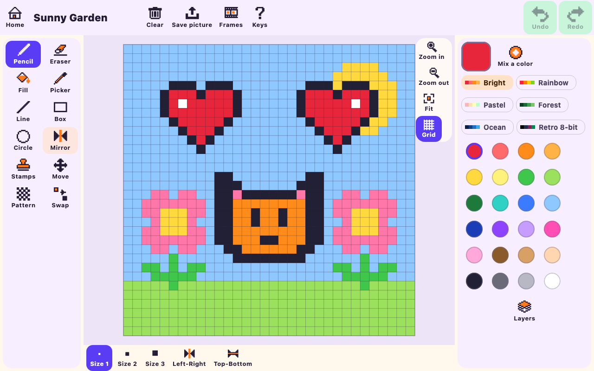
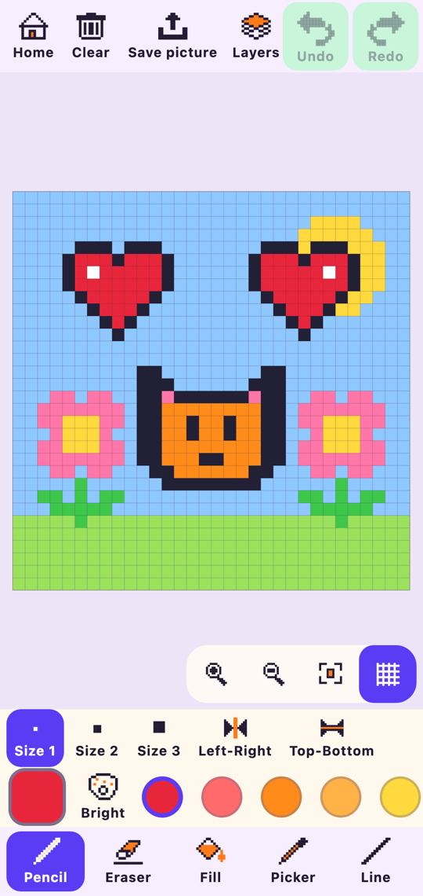
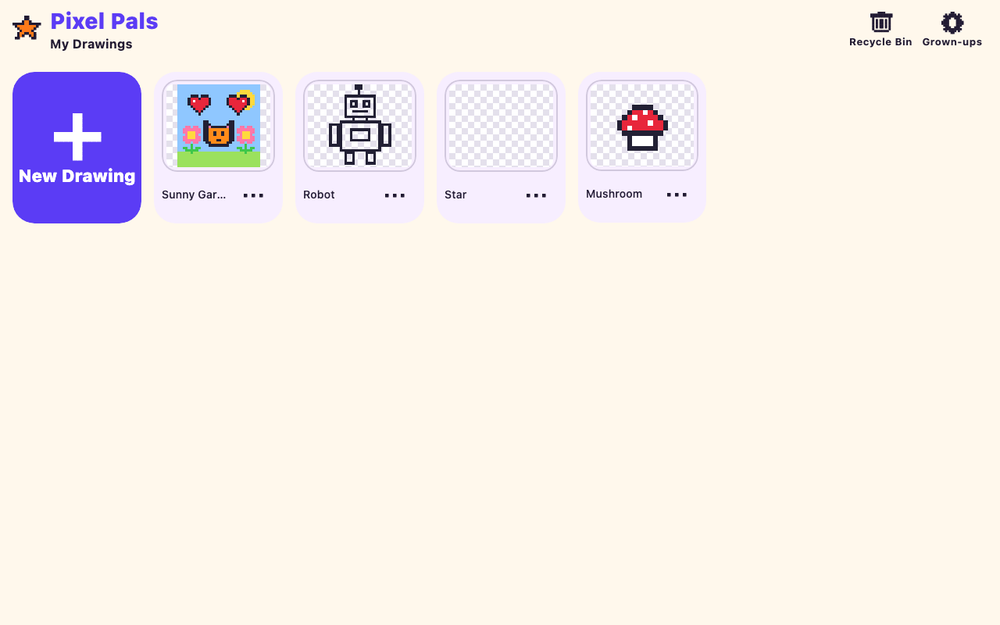
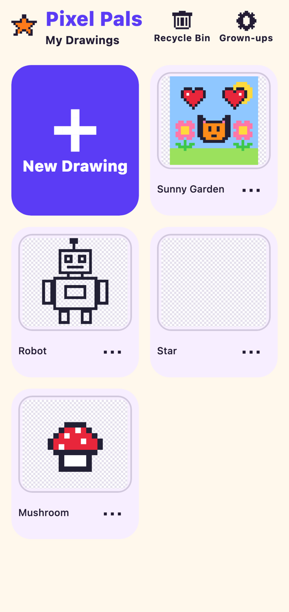

# Pixel Pals

A kid-friendly pixel art editor for **Android** and **desktop** (Windows, macOS, Linux), built from one
Kotlin Multiplatform + Compose Multiplatform codebase. It's made for children aged roughly 5–12 drawing
with a parent nearby: big buttons with words under them, a mirror mode, stamps, coloring pages,
"copy the picture" challenges and simple animation. Every change saves automatically.

It works fully offline. There are no ads, accounts, analytics or network calls, and the Android app
does not request the INTERNET permission.

| Desktop | Phone |
|---|---|
|  |  |
|  |  |

More screenshots are in [`docs/screenshots`](docs/screenshots): dark theme, the new-drawing picker,
a coloring page, a challenge and a tablet layout. The website is at
[rsantacroce.github.io/pixel-pals-site](https://rsantacroce.github.io/pixel-pals-site/).

## Download

Installers for Android, Windows, macOS (Apple Silicon and Intel) and Linux are on the
[Releases page](https://github.com/rsantacroce/pixel-pals/releases/latest). The release notes explain
how to get past the warnings for the desktop installers, which aren't code-signed yet.

## Features

- **Canvas:** Tiny 16×16, Small 32×32, Medium 64×64 and Big 128×128. A grown-up can turn on custom
  sizes up to 256×256. Grid toggle, checkerboard transparency, pinch/scroll zoom, pan and "Fit".
- **Tools:** pencil, eraser (sizes 1/2/3), bucket fill, color picker, line, box and circle (outline or
  filled, with live preview), **mirror mode** (left-right and/or top-bottom), move, stamps, a pattern
  (dither) brush and color swap.
- **Colors:** a 24-color default palette plus Rainbow, Pastel, Forest, Ocean and Retro 8-bit. There's
  also a color mixer (hue wheel and brightness slider), a "My Colors" row (up to 16, saved) and a
  recently used row.
- **Layers:** up to 4, with add, delete (after confirming), reorder, show/hide and rename.
- **Undo/redo:** one stroke is one step, with 200 levels. "Clear" asks first and can be undone.
- **Gallery and autosave:** no Save button. Changes are written about 1 s after drawing stops, and
  again when the app is paused or closed. You can duplicate, rename and delete drawings. Deleted
  drawings go to a Recycle Bin for 30 days.
- **Export:** PNG at 1×, 4×, 8× (the default) or 16×, always pixel-sharp, with a see-through or white
  background. Animations export as a GIF or a sprite sheet. On Android you can share or save to
  Pictures; on desktop you get a "Save as…" dialog.
- **Extras:** animation frames with onion skin and playback, coloring pages, "copy the picture"
  challenges with confetti, and photo import that pixelates a photo onto the palette.
- **Grown-ups area:** behind a multiplication question or a 3-second hold. It has sound, labels,
  custom sizes, theme, empty Recycle Bin, export everything as a ZIP, and reset app.
- **Desktop shortcuts:** press `?` in the editor to see them all.

## Build and run

You need **JDK 21**. For Android you also need the Android SDK (compileSdk 37); point `ANDROID_HOME`
at it or set `sdk.dir` in `local.properties`.

```bash
# Desktop: run from source
./gradlew :desktopApp:run

# Android: build a debug APK and install it on a connected device or emulator
./gradlew :androidApp:assembleDebug
adb install androidApp/build/outputs/apk/debug/androidApp-debug.apk

# All tests (unit, Compose UI, Android host tests) and lint
./gradlew allTests :core-model:testAndroidHostTest :core-io:testAndroidHostTest ktlintCheck
```

### Making a release

1. Bump `pixelpals.version` (and `pixelpals.versionCode` for Android) in `gradle.properties`.
2. Commit, then tag and push: `git tag v1.0.1 && git push origin v1.0.1`.

[`release.yml`](.github/workflows/release.yml) checks that the tag matches the version, then builds the
signed APK, the DEB, both DMGs and the MSI on their own runners and publishes them as a GitHub Release
with checksums. The Android signing key comes from repository secrets (`ANDROID_KEYSTORE_BASE64`,
`ANDROID_KEYSTORE_PASSWORD`, `ANDROID_KEY_ALIAS`, `ANDROID_KEY_PASSWORD`). Locally,
`./gradlew :androidApp:assembleRelease` builds an unsigned APK unless you set those variables, with
`ANDROID_KEYSTORE_PATH` in place of the base64 one.

### Native installers

Each installer has to be built on its own OS (this is a jpackage limitation):

```bash
./gradlew :desktopApp:packageDmg   # macOS → desktopApp/build/compose/binaries/main/dmg
./gradlew :desktopApp:packageMsi   # Windows → .../msi
./gradlew :desktopApp:packageDeb   # Linux → .../deb
```

Compose refuses to package with Homebrew's OpenJDK
([compose-multiplatform#3107](https://github.com/JetBrains/compose-multiplatform/issues/3107)).
Use a Temurin or Corretto JDK 21, or pass `-Pcompose.desktop.packaging.checkJdkVendor=false` at your
own risk.

CI ([`.github/workflows/ci.yml`](.github/workflows/ci.yml)) runs lint and every test on Linux, then
builds the debug APK and the DEB there. It builds the DMG on macOS and the MSI on Windows, and
uploads all of them as artifacts.

## Project structure

```
core-model/   Pure Kotlin: drawings, layers, frames, tools, flood fill, mirror, undo/redo (no Compose)
core-io/      .pixelpals format, gallery repository, autosave, PNG/GIF encoders, expect/actual file access
ui/           Compose Multiplatform UI: screens, components, theme, pixel icons, strings, platform services
androidApp/   Thin Android entry point (single activity, FileProvider, adaptive icon)
desktopApp/   Thin desktop entry point and installer configuration
docs/         Architecture, file format, decisions, dependency and asset licenses, screenshots
tools/        Script that regenerates the app icons
```

More reading:

- [`docs/ARCHITECTURE.md`](docs/ARCHITECTURE.md): modules, state flow, rendering and the file format
- [`docs/DECISIONS.md`](docs/DECISIONS.md): where platform limits forced a choice
- [`docs/DEPENDENCIES.md`](docs/DEPENDENCIES.md) and [`docs/ASSETS.md`](docs/ASSETS.md): licenses

## Adding a language

Strings live in `ui/src/commonMain/composeResources/values/strings.xml`. To add a language, copy that
file to `values-pt/strings.xml`, `values-es/strings.xml` and so on, then translate it. No code changes
are needed.

## License

Pixel Pals is licensed under the [Apache License 2.0](LICENSE). See [`NOTICE`](NOTICE) for attribution
and [`docs/DEPENDENCIES.md`](docs/DEPENDENCIES.md) for third-party licenses.
